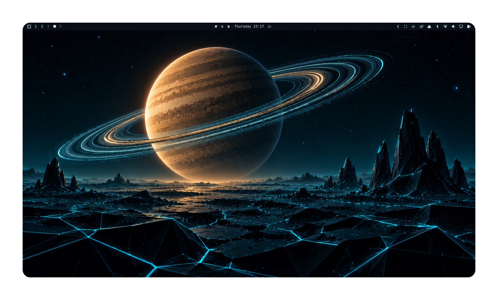
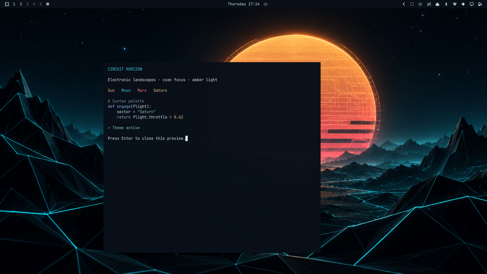
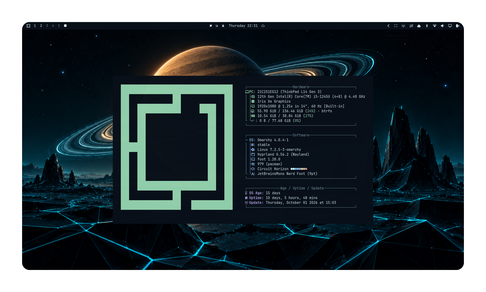
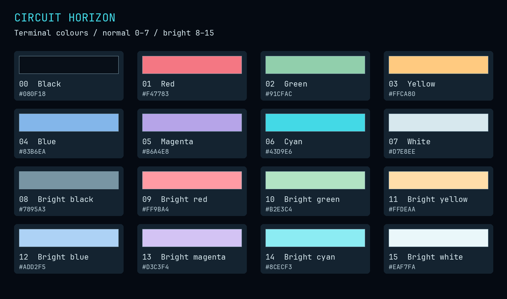
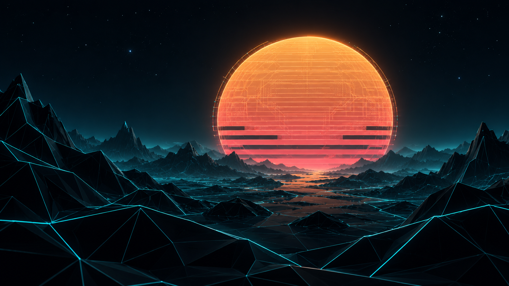
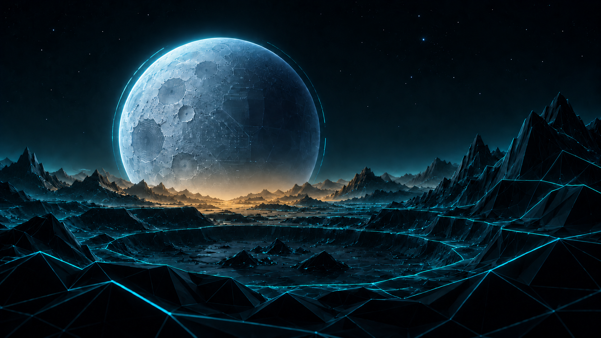
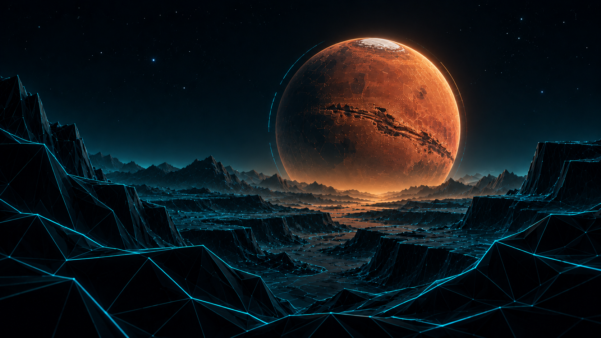
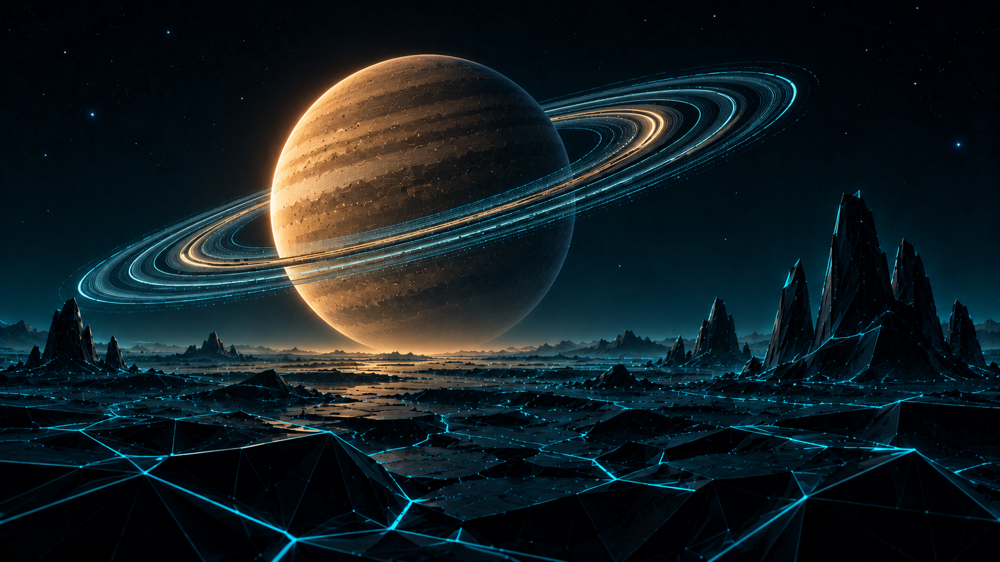

# Circuit Horizon for Omarchy

**Four electronic worlds. Cyan geometry. Amber light.**

A dark Omarchy theme built around luminous circuitry, faceted landscapes and a shared celestial palette. Soft blue-white text and restrained syntax colours keep the desktop readable while the wallpapers provide the glow.

<p align="center">
  
</p>

## Install

Install directly from GitHub:

```bash
omarchy theme install https://github.com/jennabrinning/omarchy-circuit-horizon-theme
```

Omarchy installs and applies **Circuit Horizon**.

To apply it again later:

```bash
omarchy theme set "Circuit Horizon"
```

Cycle the four worlds with `omarchy theme bg next`.

Recommended font: JetBrainsMono Nerd Font, included with Omarchy.

## On the desktop

<p align="center">
  
</p>

Small terminal sample displaying the theme's syntax colours. Window layout and transparency follow the user's desktop settings.

<p align="center">
  
</p>

Saturn wallpaper with fastfetch. Its green logo and blue labels demonstrate the softer terminal colours alongside the cyan-and-amber wallpaper.

## Terminal colour palette

Every terminal slot in index order: normal colours **0–7**, then bright colours **8–15**. The chart is generated directly from `colors.toml` and follows Omarchy's terminal templates, including the muted colour in bright-black slot 8.

<p align="center">
  
</p>

| Desktop role | Colour | Use |
| --- | --- | --- |
| Background | `#080F18` | Terminal and app surfaces |
| Deep background | `#050A12` | Darker surfaces |
| Foreground | `#D7E8EE` | Main text |
| Cyan accent | `#43D9E6` | Focus and active borders |
| Amber accent | `#FFB45C` | Secondary highlights and bar attention states |
| Selection | `#163E4B` | Text selection background |
| Selection text | `#EAF7FA` | Text within selections |
| Muted text | `#7895A3` | Comments and secondary text |

## Four worlds

All four wallpapers are **1672 × 941** approved originals. Click an image to open the full-resolution file.

<table>
  <tr>
    <td width="50%" align="center"><a href="backgrounds/01-sun.png"></a><br><b>Sun · signal horizon</b><br>Segmented light and warm circuitry.</td>
    <td width="50%" align="center"><a href="backgrounds/02-moon.png"></a><br><b>Moon · lunar circuit</b><br>Crater contours and a quiet amber light spill.</td>
  </tr>
  <tr>
    <td width="50%" align="center"><a href="backgrounds/03-mars.png"></a><br><b>Mars · copper canyon</b><br>Rust-coloured circuitry above a deep ravine.</td>
    <td width="50%" align="center"><a href="backgrounds/04-saturn.png"></a><br><b>Saturn · orbital lanes</b><br>Luminous rings above open plains and angular spires.</td>
  </tr>
</table>

The palette connects the set; each world has its own silhouette and terrain. Landscape displays work best. Fill mode on ultrawide, 16:10 or portrait displays may crop celestial objects. These are not native 4K images.

## Artwork and license

The four Circuit Horizon wallpapers were generated and refined with OpenAI image generation.

[MIT licensed](LICENSE). Circuit Horizon is a community theme, not affiliated with Omarchy, TRON or Disney.
